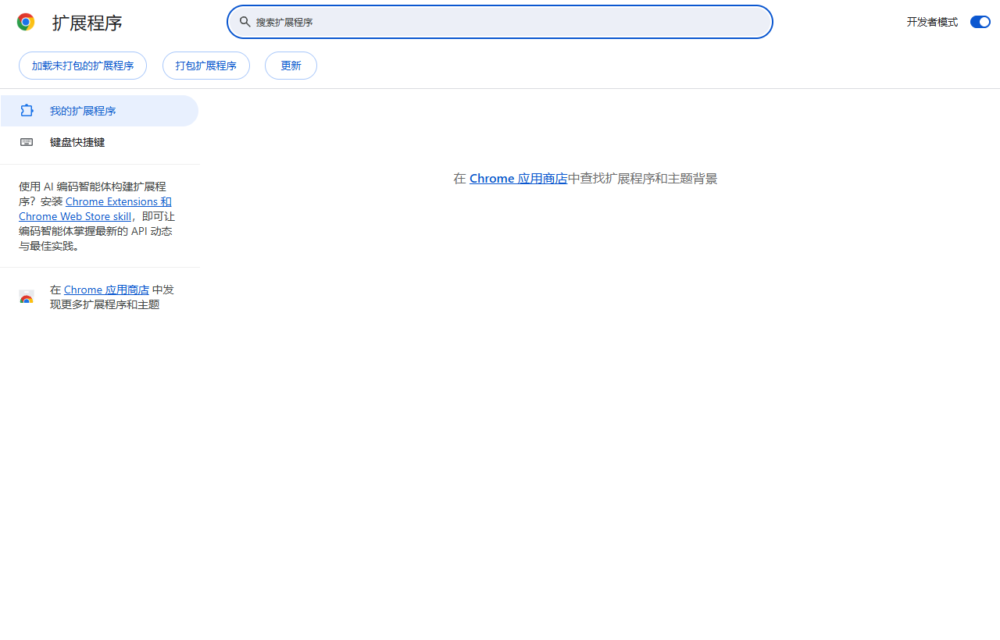
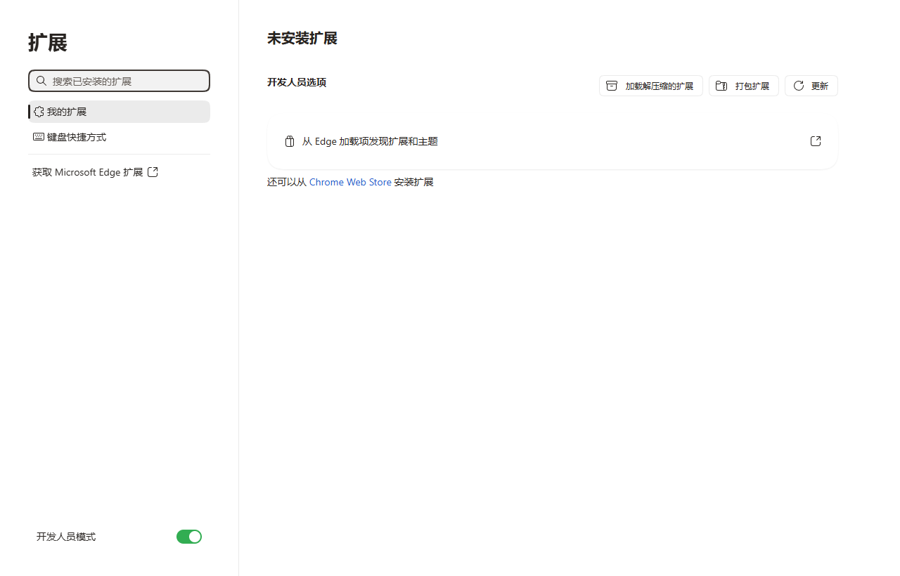

# 羽约 1.1.0：Chrome 与 Edge 合并使用指南

## 一、解压和导入

下载 Release 中的 `Court-1.1.0.zip`，右键解压到固定位置。不要直接在 ZIP 里选择文件，不要在导入后移动文件夹。

| 浏览器 | 地址栏输入 | 操作 |
| --- | --- | --- |
| Chrome | `chrome://extensions` | 开启开发者模式 → 加载已解压的扩展程序 |
| Edge | `edge://extensions` | 开启开发者模式 → 加载解压缩的扩展 |

两种浏览器都选择解压后的 **extension** 文件夹，里面应直接包含 `manifest.json`。从 GitHub 下载源码时也选择源码内的 extension 文件夹。

Chrome 扩展管理页面（安装入口截图，浏览器版本不同可能略有差异）：

Edge 扩展管理页面：

导入后，在浏览器右上角扩展菜单固定「羽约」。这是本地导入版，不会从商店自动更新。更新时先结束旧任务，替换文件、点击扩展卡片的重新加载，再刷新学校页面。

## 二、进入正确页面

打开 https://booking.cuhk.edu.cn/index 并自行登录。依次选择「运动场地 → 羽毛球场 → 预订」，看到日期、场地名称、时间列的日历后再打开插件。

地址通常为 `https://booking.cuhk.edu.cn/a/field/client/main`。如果登录过期，先在学校页面完成登录。插件复用当前浏览器登录状态，不保存密码，也不会启动其他账号。

## 三、先做一次不提交演练

1. 选择学校已开放、尚未开始的打球日期和一小时时段，填写联系电话、主题、参与人数、用途说明。
2. 点击「10 秒倒计时演练 · 只填表」。即使之前取消了测试勾选，这个按钮也强制只填表。
3. 保持日历标签页可见，10 秒后应自动刷新、选场、打开表单、填写并校验必填项。
4. 状态显示「已填表 · 未提交」时检查表单。插件不会点击提交，也不会进入查单流程。
5. 查看日志中的刷新、打开表单、填写及「到点至填好」耗时。测试数据受当时网络和服务器负载影响。
6. 在学校页面关闭表单。若没有空闲场地，任务会在有限窗口内重试后结束，不能凭空产生可预约时段。

「只填表，停在提交前」配合「开始填表测试」使用的是正常放号时刻；想立刻开始短倒计时，请使用独立的 10 秒演练按钮。

## 四、21:58 安排正式预约

填写后天的打球日期和单个一小时的时段，确认上方显示的放号时间为今晚北京时间 22:00。取消「只填表，停在提交前」，点击「确认自动提交一个场地」。

看到「已安排，等待放号」以及准备完成日志后，保持日历标签页可见、电脑唤醒。可以关闭插件弹窗。不要切换账号、修改日期或手动选择场地。已过放号时刻的任务会立即执行。

默认优先级：6；4/5/7；11/12/13/14；3/8；9/10；1/2。只会提交一个场地，学校仍会检查配额和预约权限。

## 五、怎么看结果

| 状态 | 下一步 |
| --- | --- |
| 已安排 / 正在执行 | 保持学校日历页可见；需要取消时点「停止」 |
| 已填表 · 未提交 | 只填表测试完成；检查表单并关闭它 |
| 提交阶段 / 核验订单 | 等待核验，不要重复点击学校提交按钮 |
| 预约已核实 | 到学校「我的预订」确认日期、时段、场地、审核状态 |
| 结果待人工核验 | 自行检查学校订单；查清后才能结束待查任务再建新任务 |
| 任务异常 | 阅读日志，处理登录、日期、配额或页面结构问题 |

「学校订单已生成，等待审核」不等于审核通过。停止插件不能撤销已经提交的学校订单。

提交后仅当本次新提示明确指出场地已被他人预订，才会自动换场。超时、普通失败或暂未查到订单都会保留提交锁，不自动再次提交。

## 六、排查问题

- 无法导入：选择含 manifest.json 的 extension 文件夹，确认不是 ZIP 或外层目录。
- 插件提示页面不对：重新进入学校羽毛球日历，再刷新一次页面。
- 学校网页调整：使用「页面检查 → 导出页面结构」。它不导出输入值，但分享前仍请检查文件。
- 点击开始后立即运行：所选打球日期的放号时间已经过去，属正常行为。
- 没有抢到：服务器延迟、被别人占用或本账号配额不足都可能导致失败，插件不保证抢到。
- 更新后旧任务停止：这是升级保护；先检查学校订单，避免把旧提交当成新任务重试。

不要公开上传含个人姓名、邮箱、电话、订单号的真实截图或原始日志。反馈建议提供版本号、浏览器版本、阶段、已脱敏的提示和耗时。
